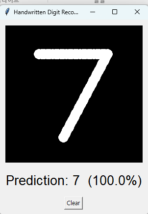

# Study-01: 손글씨 숫자 인식 (MNIST)

PyTorch로 MNIST 데이터셋을 학습시킨 CNN 모델로, Tkinter GUI에서 마우스로 직접 숫자를 그리면 실시간으로 인식하는 프로젝트입니다.

## 실행 화면

<p align="center">
  
</p>

검은 캔버스에 숫자를 그리고 마우스를 떼면 예측한 숫자와 신뢰도(%)가 아래에 표시됩니다. `Clear` 버튼으로 캔버스를 지우고 다시 그릴 수 있습니다.

## 주요 기능

- 280x280 캔버스에 마우스로 자유롭게 숫자 필기
- 마우스를 떼는 순간 자동 예측, 예측 숫자와 확률(%) 표시
- 학습 시 CUDA 사용 가능하면 GPU를 자동 사용
- 학습과 추론이 같은 모델 정의(`model.py`)를 공유

## 구성

| 파일 | 역할 |
| --- | --- |
| `model.py` | `DigitCNN` 모델 정의 (28x28x1 입력 → conv/pool 2회 → 7x7x64 → fc → 10개 클래스 출력) |
| `train.py` | MNIST로 학습/평가 후 가중치를 `mnist_cnn.pt`로 저장 |
| `draw_and_predict.py` | Tkinter 캔버스 GUI, 28x28로 축소해 같은 정규화를 적용한 뒤 예측 |
| `mnist_cnn.pt` | 학습된 가중치 |

## 동작 흐름

1. 사용자가 캔버스에 그리면 화면과 동시에 메모리의 PIL 이미지(흑백, 검은 배경)에도 같은 획이 기록됩니다.
2. 마우스를 떼면 이미지를 28x28로 축소합니다.
3. 학습 때와 같은 정규화(mean 0.1307, std 0.3081)를 적용합니다.
4. `DigitCNN`의 softmax 출력 중 가장 높은 클래스와 그 확률을 화면에 표시합니다.

## 학습 설정

| 항목 | 값 |
| --- | --- |
| 옵티마이저 | Adam |
| 학습률 | 1e-3 |
| 배치 크기 | 64 |
| 에폭 | 5 |

## 실행 방법

모든 명령은 `handwriting_digit_recognition/` 폴더 안에서 실행합니다.

```bash
python train.py              # DigitCNN을 MNIST로 학습시키고 mnist_cnn.pt에 가중치 저장
python draw_and_predict.py   # Tkinter GUI 실행, 숫자를 그리고 마우스를 떼면 예측 결과 표시
```

`train.py`를 처음 실행하면 `./data` 폴더에 MNIST 데이터셋이 자동으로 다운로드됩니다. 이미 학습된 `mnist_cnn.pt`가 있으므로 `draw_and_predict.py`만 바로 실행해도 됩니다.

## 의존성

`torch`, `torchvision`, `Pillow`(PIL), `tkinter`(표준 라이브러리, Tk 지원이 포함된 Python 필요). 별도의 테스트 코드나 requirements 파일은 없습니다.

## 주의사항

- `model.py`에서 `DigitCNN`의 구조를 바꾸면 기존 `mnist_cnn.pt`와 맞지 않게 되므로, `train.py`를 다시 실행해 가중치를 새로 생성해야 합니다. 그렇지 않으면 `draw_and_predict.py`에서 `load_state_dict` 시 shape mismatch 오류가 발생합니다.
- `draw_and_predict.py`의 전처리 로직과 `train.py`의 `transforms.Normalize` 값(mean/std)은 서로 동기화되어 있어야 합니다. 현재는 두 파일에 동일한 값이 각각 하드코딩되어 있습니다.
