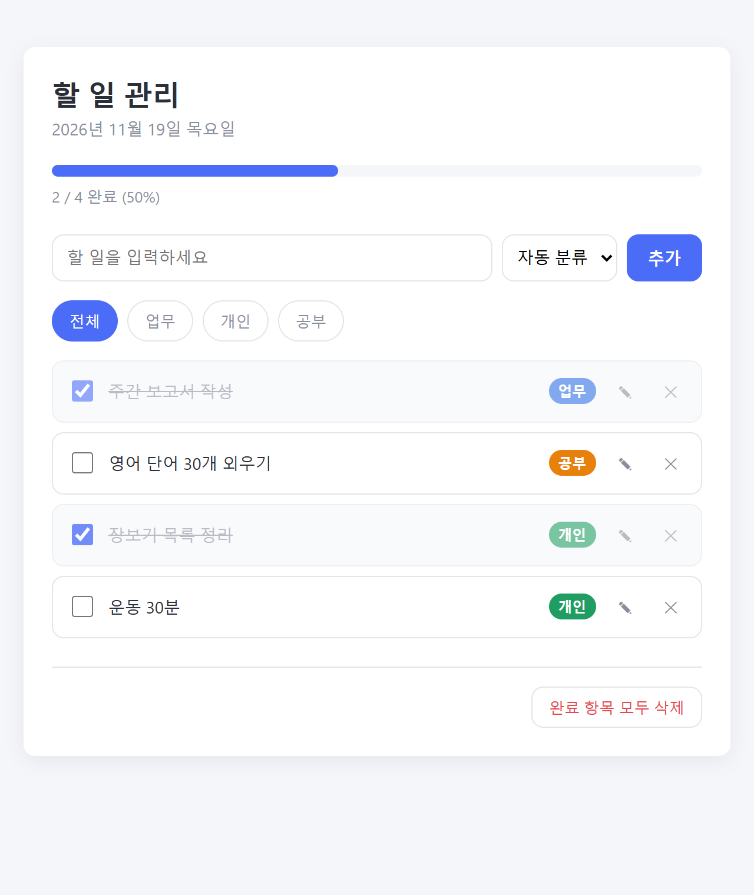

# Study-02: 할 일 관리

HTML, CSS, 바닐라 JavaScript만으로 만든 할 일 관리 앱입니다. 설치, 빌드, 외부 라이브러리가 없습니다.

## 실행 화면

  

완료한 항목은 취소선으로 표시되고, 상단 진행 바에 완료 비율이 나타납니다. 항목마다 카테고리 배지와 수정(✎), 삭제(✕) 버튼이 있습니다.

## 주요 기능

- 할 일 추가 (버튼 또는 Enter)
- 완료 체크(취소선), 개별 삭제, 완료 항목 일괄 삭제
- 항목 더블클릭 또는 ✎ 버튼으로 텍스트와 카테고리 수정 (Enter/포커스 이탈 시 저장, Esc 취소)
- 업무 / 개인 / 공부 카테고리 지정, 탭 필터, 필터 기준 진행률 표시
- 카테고리를 "자동 분류"로 두면 텍스트의 키워드를 보고 카테고리를 자동 지정
- 새로고침해도 데이터 유지

## 구성

| 파일 | 역할 |
| --- | --- |
| `index.html` | 화면 구조 |
| `style.css` | 스타일 (카테고리별 배지 색상 포함) |
| `app.js` | 저장, 상태, 변경 함수, 렌더링, 이벤트 연결 |
| `web_version/` | 위 세 파일과 내용이 같은 사본 |
| `todo-app-conversation.txt` | 앱을 만들며 나눈 대화 기록 |

## 실행 방법

`index.html`을 브라우저에서 열기만 하면 됩니다. `file://`로도 동작합니다.

## 데이터 저장

데이터는 브라우저 `localStorage`(`todos` 키)에 `{id, text, category, done, createdAt}` 배열로 저장됩니다. 저장된 값이 손상되었거나 `localStorage`를 쓸 수 없으면 앱이 멈추지 않고 경고 배너를 보여 줍니다.

## 카테고리 추가하기

`index.html`(옵션과 필터 탭), `app.js`의 `CATEGORY_LABELS`, `style.css`의 `.badge-<값>` 규칙을 함께 수정합니다.
