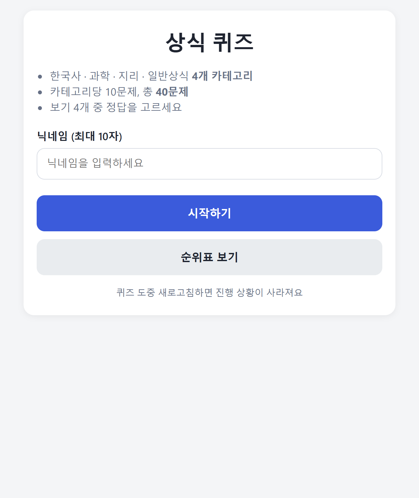
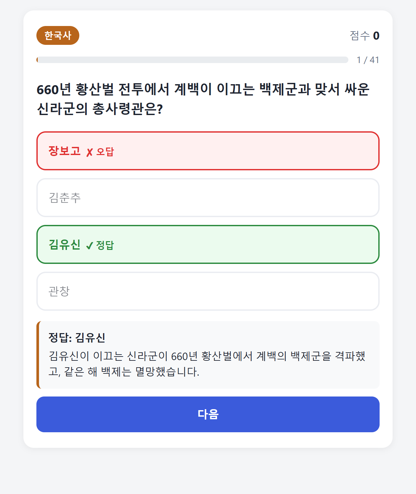
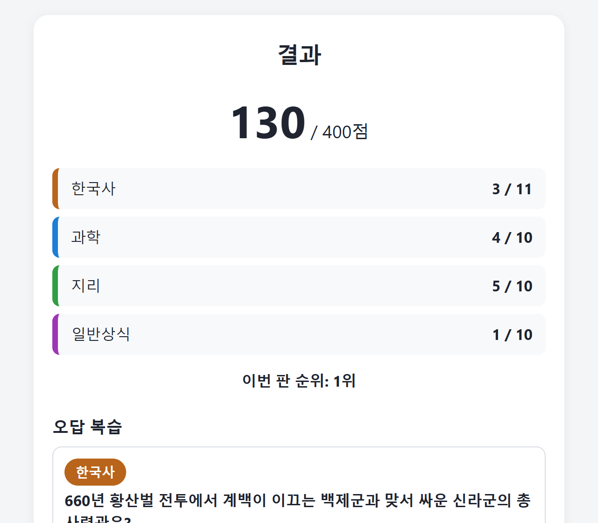
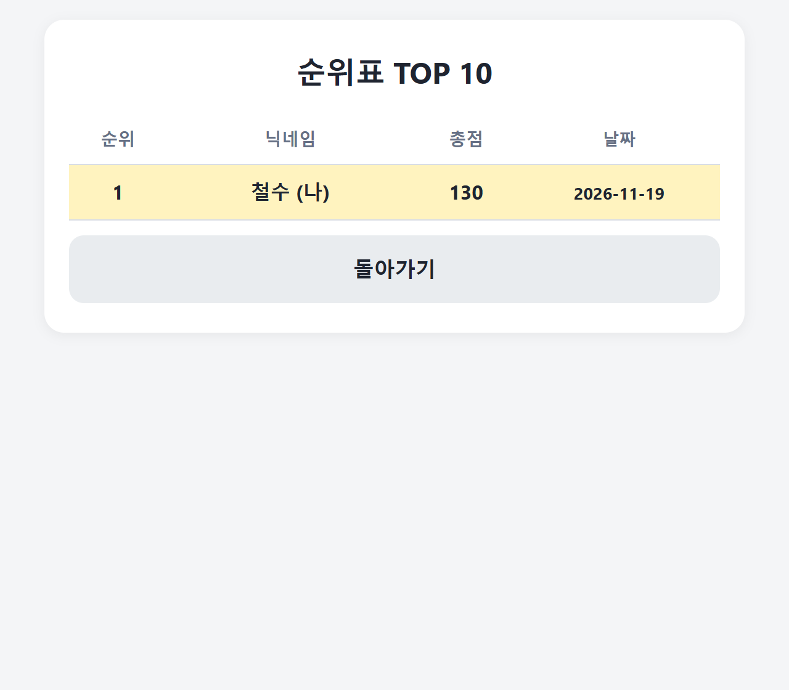

# 상식 퀴즈

한국사, 과학, 지리, 일반상식 4개 카테고리를 풀고 점수를 순위표에 남기는 퀴즈 앱입니다. 외부 라이브러리, 빌드, 네트워크가 필요 없습니다.

## 실행 화면

| 시작 | 퀴즈 진행 |
| :---: | :---: |
|  |  |

| 결과 | 순위표 |
| :---: | :---: |
|  |  |

## 주요 기능

- 닉네임(최대 10자)을 입력하고 시작
- 한국사 → 과학 → 지리 → 일반상식 순서로 진행, 카테고리가 끝나면 요약 화면 표시
- 답을 고르면 정답 여부와 해설을 바로 보여 줌
- 결과 화면에서 카테고리별 점수, 이번 판 순위, 오답 복습 제공
- 순위표 TOP 10

## 규칙

- 문제와 보기 순서는 매 판 섞입니다.
- 정답 1개당 10점이며, 한 번 고른 답은 바꿀 수 없습니다.
- 키보드: 1~4번(보기 선택), Enter(다음)
- 순위는 브라우저 `localStorage`(`quizRanking`)에 최대 100건 저장하고, 순위표에는 상위 10개를 보여 줍니다. 같은 점수면 먼저 기록한 사람이 위입니다.
- 퀴즈 도중 새로고침하면 진행 상황이 사라지고 시작 화면으로 돌아갑니다.

## 구성

| 파일 | 역할 |
| --- | --- |
| `index.html` | 시작, 퀴즈, 요약, 결과, 순위표 5개 화면 |
| `style.css` | 스타일 |
| `app.js` | 화면 전환, 출제, 채점, 순위 저장 |
| `questions.js` | 문제 데이터(`QUESTIONS` 배열) |
| `.claude/commands/` | 문제 관리용 Claude Code 슬래시 명령 |
| `CLAUDE.md` | 문제 교차 검증 가이드라인 |

## 실행 방법

`index.html`을 브라우저에서 열면 바로 실행됩니다.

## 문제 추가

`questions.js`의 `QUESTIONS` 배열에 아래 형식으로 추가합니다.

```js
{ id, category, question, choices(4개), answerIndex(0~3), explanation }
```

`category`는 `history`, `science`, `geography`, `general` 중 하나이며, 카테고리마다 10문제씩 출제하므로 개수를 맞춰야 합니다.

## 슬래시 명령 (Claude Code)

| 명령 | 설명 |
| --- | --- |
| `/quiz-add <카테고리> <난이도>` | 문제 1개를 추가 (난이도: E/M/H) |
| `/quiz-range <시작> <끝>` | 지정한 번호 범위의 난이도와 정답 분포를 검토 |
| `/quiz-validate [카테고리]` | 최상급 표현이 들어간 문제를 찾아 기준이 명시됐는지 검증 |
