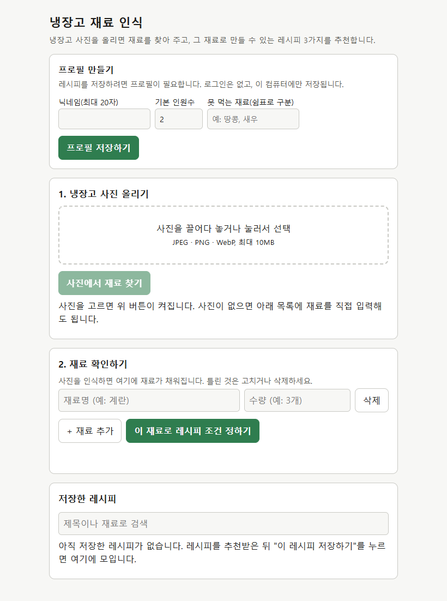
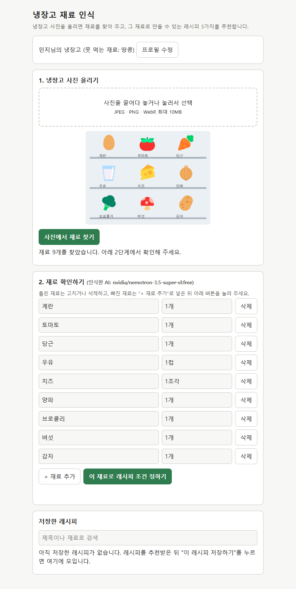
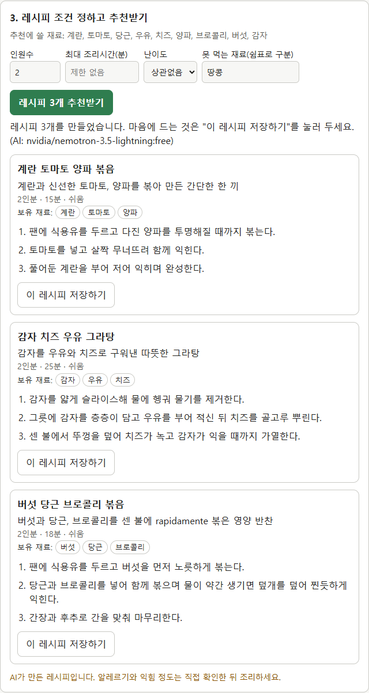
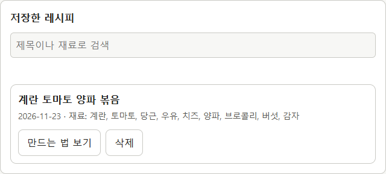

# 냉장고를 부탁해

냉장고 사진을 올리면 AI가 재료를 찾아 주고, 그 재료로 만들 수 있는 레시피 3개를 추천하는 웹 앱입니다. 추천받은 레시피는 저장해 두고 다시 볼 수 있습니다. Python + FastAPI로 만들었고, OpenRouter의 무료 모델을 사용합니다.

## 실행 화면

실제로 서버를 띄우고 OpenRouter 무료 모델을 호출해 찍은 화면입니다. 냉장고 사진은 이모지로 그린 샘플 이미지입니다.

| 시작 | 재료 인식 결과 |
| :---: | :---: |
|  |  |

| 레시피 추천 | 저장한 레시피 |
| :---: | :---: |
|  |  |

## 주요 기능

1. **사진에서 재료 찾기**: 냉장고 사진을 올리면 비전 모델이 재료 이름, 수량, 확신도를 JSON으로 돌려줍니다. 확신이 낮은 재료는 따로 표시되고, 목록은 직접 고치거나 추가할 수 있습니다.
2. **레시피 3개 추천**: 확정한 재료와 조건(인원수, 난이도, 제외 재료)으로 레시피를 만듭니다. 재료 목록에 없는 재료는 "보유"가 아니라 "부족한 재료"로 분리하고, 제외 재료가 들어간 레시피는 서버에서 걸러냅니다.
3. **프로필과 저장**: 로그인 없이 프로필 1개(제외 재료, 기본 인원수)를 쓰고, 마음에 드는 레시피를 저장·검색·삭제합니다. 같은 제목에 재료 구성도 같은 레시피는 중복 저장되지 않습니다.

## 실행 방법

1. 의존성을 설치합니다.

   ```
   pip install -r requirements.txt
   ```

2. `.env.example`을 `.env`로 복사하고 [OpenRouter](https://openrouter.ai) API 키를 넣습니다. `.env`는 git에 올라가지 않습니다.

   ```
   OPENROUTER_API_KEY=sk-or-v1-...
   ```

3. 서버를 실행하고 브라우저에서 http://127.0.0.1:8000 을 엽니다.

   ```
   python -m app.main
   ```

## 사용 모델

모두 OpenRouter 무료 모델이며, 앞의 모델이 실패하면 뒤의 모델로 넘어갑니다.

| 용도 | 기본 | 대체 |
| --- | --- | --- |
| 사진 인식 | `nvidia/nemotron-3.5-super-vl:free` | `nvidia/nemotron-3-nano-omni-30b-a3b-reasoning:free` |
| 레시피 생성 | `nvidia/nemotron-3.5-lightning:free` | `nvidia/nemotron-3-ultra-550b-a55b:free` |

## 알아 둘 점

- **레시피 생성은 30~60초 걸립니다.** 추론 모델이라 응답이 느리고, 화면에 경과 시간과 취소 버튼이 나옵니다. 서버는 전체 180초가 넘으면 중단합니다.
- 무료 모델이라 혼잡할 때 429나 504가 날 수 있습니다. 잠시 뒤 다시 누르면 됩니다.
- 사진과 재료 정보는 OpenRouter의 무료 모델 제공자에게 전달됩니다. 개인 정보가 찍힌 사진은 올리지 마세요.
- 사진은 10MB 이하, JPEG/PNG 등 일반 이미지여야 하며 서버에서 크기를 줄여 보냅니다.
- AI가 재료를 잘못 읽거나 제외 재료를 놓칠 수 있습니다. 알레르기가 있다면 결과를 직접 한 번 더 확인하세요.

## 보안

로그인이 없는 앱이라 **내 컴퓨터에서만** 쓰도록 만들었습니다.

- 서버는 `127.0.0.1`에만 바인딩됩니다. 외부에 열지 마세요.
- `Host`가 `127.0.0.1:8000`/`localhost:8000`이 아닌 요청과, 다른 사이트에서 온 상태 변경 요청(`Origin` 불일치)은 403으로 거절합니다.
- 다른 사이트가 화면을 iframe으로 삽입하지 못하도록 `X-Frame-Options`와 CSP 헤더를 붙입니다.
- 모델이 만든 글은 화면에 `textContent`로만 넣어 HTML로 해석되지 않습니다.
- API 키는 서버의 `.env`에서만 읽고 브라우저로 나가지 않습니다.

## 구성

| 경로 | 역할 |
| --- | --- |
| `app/main.py` | 앱 설정, 보안 미들웨어, `POST /api/recognize`(재료 인식) |
| `app/recipes.py` | `POST /api/recipes`(레시피 생성과 결과 검증) |
| `app/saved.py`, `app/db.py` | 프로필·저장 레시피 API와 SQLite(`data/app.db`) |
| `app/openrouter.py` | OpenRouter 호출, 재시도, 모델 대체 |
| `app/env.py` | `.env` 로드 |
| `app/static/index.html` | 화면(바닐라 HTML/CSS/JS) |
| `PRD_step1.md` ~ `PRD_step3.md` | 단계별 요구사항 문서 |
| `.claude/agents/` | 코드 리뷰, 성능 최적화, UX 개선용 Claude Code 서브에이전트 |
| `CLAUDE.md` | Claude Code용 프로젝트 가이드 |

### API

| 메서드 | 경로 | 설명 |
| --- | --- | --- |
| POST | `/api/recognize` | 사진에서 재료 인식 |
| POST | `/api/recipes` | 레시피 3개 생성 |
| GET / PUT | `/api/profile` | 프로필 조회 / 저장 |
| GET / POST | `/api/saved` | 저장한 레시피 목록(검색) / 저장 |
| DELETE | `/api/saved/{id}` | 저장한 레시피 삭제 |

## 서브에이전트 (Claude Code)

`.claude/agents/`에 이 프로젝트를 점검하려고 만든 에이전트 3개가 있습니다. 코드 리뷰 → 성능 최적화 → UX 개선 순서로 한 번 돌려서 파싱 견고성, 재시도 한도, 이미지 처리, 에러 메시지를 고쳤습니다.

| 에이전트 | 역할 |
| --- | --- |
| `code-reviewer` | 버그, 보안, 코딩 규칙, 성능 제안을 보고만 함 (수정 안 함) |
| `performance-optimizer` | 측정으로 병목을 찾아 고치고 전후 수치를 비교 |
| `ux-designer` | 화면 흐름, 버튼 문구, 에러 메시지, 접근성 개선 |

## 한계

- 자동 테스트가 없습니다. 파서와 재시도 로직은 모킹으로, 화면은 가짜 응답으로 확인했고 실제 사진으로 처음부터 끝까지 도는 검증은 충분하지 않습니다.
- 프로필이 1개뿐이라 여러 사람이 나눠 쓸 수 없습니다.
- 무료 모델의 가용성과 속도는 OpenRouter 사정에 따라 달라집니다.
