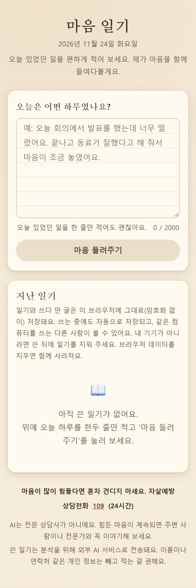
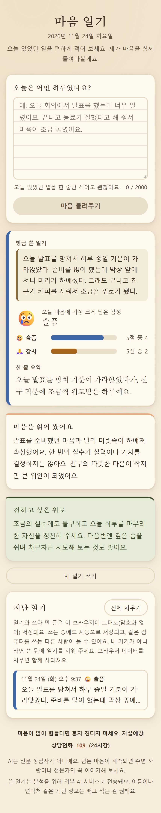
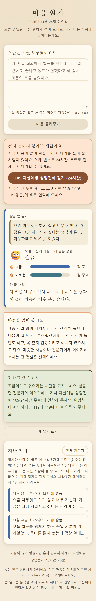
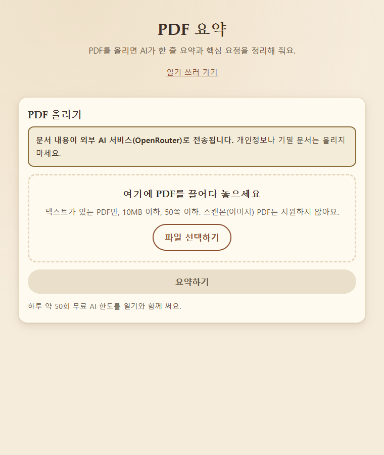
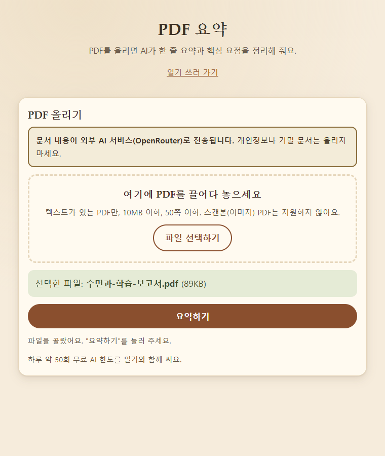
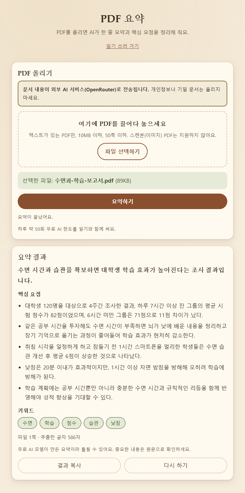
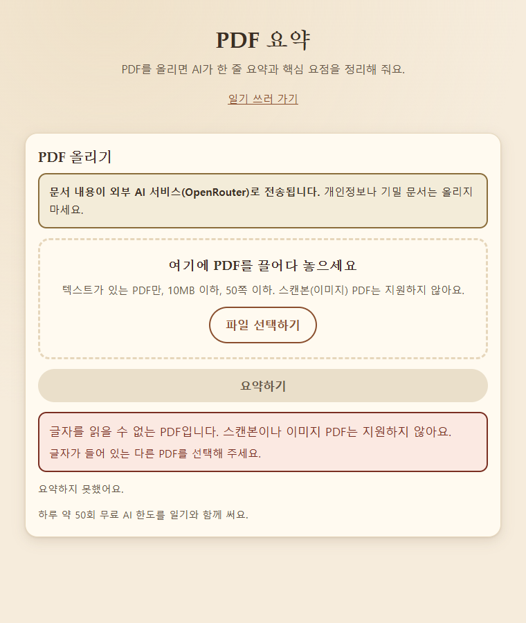

# AI 공감 다이어리

일기를 쓰면 AI(OpenRouter 무료 모델)가 감정을 분석하고 공감·위로 메시지를 돌려주는 로컬 웹 앱입니다.
일기 기록은 서버가 아니라 브라우저(localStorage)에만 저장됩니다.
같은 서버에서 PDF를 올리면 한국어로 요약해 주는 화면(`index_pdf.html`)도 쓸 수 있습니다.

## 실행 화면

실제 서버 코드와 화면으로 찍었습니다. 다만 무료 호출 한도(하루 50회)를 아끼려고, 모델 호출 부분만 앞서 실제 OpenRouter 무료 모델을 호출해 받은 응답을 그대로 재생하도록 바꿨습니다. 일기 내용은 예시로 직접 쓴 글입니다.

| 시작 | 일반 일기 결과 |
| :---: | :---: |
|  |  |

| 위기 표현이 있는 일기 | 지난 일기 목록 |
| :---: | :---: |
|  |  |

## 준비
- Python 3.11 이상 (`asyncio.timeout` 사용)
- [OpenRouter](https://openrouter.ai) API 키

```powershell
pip install -r requirements.txt
Copy-Item .env.example .env      # 복사한 .env 안의 OPENROUTER_API_KEY 값을 본인 키로 바꾸기
```

## 실행 (Windows PowerShell, 이 폴더에서)
```powershell
python -m uvicorn app.main:app --host 127.0.0.1 --port 8000
```
브라우저에서 http://127.0.0.1:8000 으로 접속합니다. (`localhost:8000`도 가능)
종료는 터미널에서 Ctrl+C.

- 포트·주소(127.0.0.1:8000)를 바꾸면 서버의 Host/Origin 검사에 막힙니다. 바꾸려면 `app/main.py`의 `HOST`, `PORT`도 같이 고쳐야 합니다.
- 이 폴더가 아닌 곳에서 실행하면 `app`을 찾지 못합니다. 스크립트에서 `app`을 import할 때는 `PYTHONPATH=.`이 필요합니다.

## PDF 요약
서버를 켠 뒤 http://127.0.0.1:8000/index_pdf.html 로 접속해 PDF를 끌어다 놓거나 선택하면 한국어 요약이 나옵니다. 일기와 같은 모델·무료 한도(하루 50회, 동시 3개)를 함께 씁니다.

### PDF 요약 실행 화면

이 화면들은 일기 화면과 달리 모델 응답을 재생하지 않고 실제 OpenRouter 무료 모델을 한 번 호출해 찍었습니다. 문서는 예시로 직접 만든 짧은 PDF입니다.

| 시작 | 파일 선택 후 |
| :---: | :---: |
|  |  |

| 요약 결과 | 글자가 없는 PDF를 올렸을 때 |
| :---: | :---: |
|  |  |

- 올린 파일은 서버가 디스크에 저장하지 않고, 텍스트만 추출해 요약합니다.
- 제한: 10MB 이하, 50쪽 이하. 글자를 추출할 수 없는 스캔본(이미지) PDF는 요약되지 않습니다.
- 추출한 텍스트의 앞 8,000자만 요약합니다. 더 긴 문서는 화면에 일부만 요약했다는 안내가 뜹니다.
- 위기 표현 안내 박스는 일기 화면에만 있고, PDF 요약에는 적용되지 않습니다.
- PDF 추출에 pymupdf(AGPL 라이선스)를 씁니다. 공개 배포할 때는 라이선스를 확인하세요.
- 기획과 API 계약은 `docs/PRD_pdf.md`에 있습니다.

## index.html·index_pdf.html을 더블클릭하면 안 되는 이유
두 파일 모두 직접 열면 주소가 `file://...`가 되어 서버(`/api/diary`)에 요청을 보낼 수 없고, 서버도 허용되지 않은 출처로 거절합니다.
반드시 서버를 켠 뒤 위 주소로 접속하세요.

## 무료 한도
무료 모델은 계정당 하루 50회까지입니다. 초과하면 "오늘 쓸 수 있는 무료 AI 사용량을 다 썼어요" 안내가 나오고,
한도는 한국 시간 오전 9시(UTC 00:00)에 초기화됩니다. 한도가 소진된 뒤에는 재시도해도 소용없습니다.

## 안전 안내
일기에 위기 표현이 있으면 AI 호출이 실패해도 화면이 자살예방 상담전화 109(24시간), 긴급 시 112·119 안내 박스를 보여 줍니다(서버는 오류 응답에 `crisis: true`만 붙이고, 안내 문구는 화면이 책임집니다).
이 앱은 의료·상담 서비스가 아닙니다.
